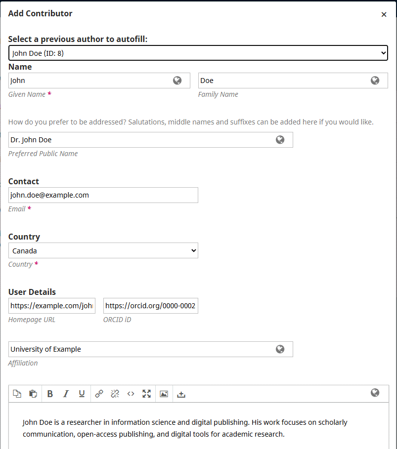

# ojs-author-autofill

Autofill Contributor Details from Previously Used Authors

# OJS Author Autofill

An enhancement for Open Journal Systems (OJS) that allows users to select authors from previous submissions and automatically populate contributor details in the author form.

## Features

* Select a previously used author from a dropdown list.
* Automatically populate available author details, reducing repetitive data entry.
* Simplify adding contributors to new submissions.

### Example

## Compatibility

* **OJS version:** 3.3.0-23
* **Implementation:** Modification of two existing PKP/OJS files.
* **Status:** Working prototype; community testing welcome.

## Repository Structure

* `ojs-3.3.0-23.001-original/` — Original files from OJS 3.3.0-23.
* `ojs-3.3.0-23.002-updated/` — Modified files implementing Author Autofill.

Both directories contain the following files at their respective paths:

* `lib/pkp/controllers/grid/users/author/form/PKPAuthorForm.inc.php`
* `lib/pkp/templates/controllers/grid/users/author/form/authorForm.tpl`

## Known Limitations and Possible Improvements

The current implementation may display multiple records with different IDs for the same author. It could be improved by displaying only the record with the highest ID for each author.

There is always room for improvement, and community feedback and contributions are welcome.

## Installation

This prototype modifies existing OJS/PKP files; it is not currently a standalone OJS plugin.

Before testing:

1. Back up the original files.
2. Confirm that the files come from the same OJS/PKP version.
3. Apply the modifications to a test installation.
4. Test author selection and autofill before using it on a production journal.

Do not overwrite customized files without reviewing the differences.

## Feedback and Testing

Feedback and testing by the OJS/PKP community are welcome. Please report compatibility issues, bugs, and suggestions through the repository's Issues section.

## License

See the repository's license file. Original OJS/PKP copyright and license notices should be preserved in the source files.
